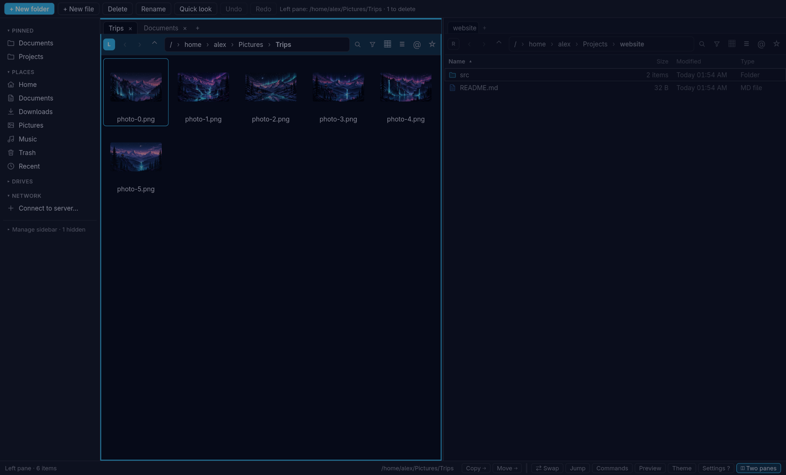

# Inode

A keyboard-first, two-pane file manager for [Omarchy](https://omarchy.org) and Hyprland. It follows your
Omarchy theme live, can replace the default file manager (and the browser "Open folder" dialog) with one
command, and undoes that just as easily. Built with Tauri 2: a Rust backend and a plain HTML/JS interface
with no bundler.



Status: early. It is my daily file manager, but expect rough edges. Bug reports are welcome.

## Install

- **AppImage:** download the latest from [Releases](https://github.com/matthewjaybarr-png/inode/releases),
  `chmod +x` it and run it.
- **Arch / Omarchy (AUR):** `yay -S inode` (builds from source; see `packaging/aur`).
- **From source:** see Build below.

## What it does

- Two panes side by side (F3 for one), tabs in each pane, copy or move to the other pane.
- Rebindable keys with default, Windows and vim presets; `?` shows every key.
- Pinned files and folders, a quiet sidebar you can hide entries from, eject for removable drives.
- Preview pane for text, images and PDFs; search in a folder and below it.
- Copy, cut and paste with other apps; drag and drop; new file and folder; rename.
- Trash with restore, a Trash place and a Recent place; undo and redo.
- Folder aliases (`@name` in the path bar), breadcrumb drop-downs, a details pane, settings export and import.
- Grid view with thumbnails, folder item counts, column chooser, per-folder views; bulk rename, `/` filter, `:` jump, command palette, quick look (Space), tabs reopen at start.
- Colour tags (seven colours, a Tags list in the sidebar), search inside files (ripgrep when installed), and your own right-click commands as `.toml` files in omanta's format (Settings: Open actions folder).
- On Linux: network places and Connect to server (Ctrl+K), phones and encrypted drives through gio/udisks, and an opt-in file chooser for other apps (`inode --picker on`).
- Compress to zip; extract zip, 7z, tar and rar (through `bsdtar`).
- Locked folders: password-protected folders through `gocryptfs`.
- Follows the Omarchy theme live.
- Can be the default file manager: "Show in folder" from browsers opens Inode.

## Build

Needs Rust, Node and the [Tauri 2 prerequisites](https://tauri.app/start/prerequisites/).

```bash
npm install
npm run build -- --bundles appimage
```

Tests: `npm test` and `cargo test --lib` in `src-tauri`.

## Make it the default file manager

```bash
inode --default on
```

This sets the folder handler, the `org.freedesktop.FileManager1` service and the file-manager keys in
`~/.config/hypr/bindings.lua`, all per user. `inode --default off` puts everything back as it was, and
`inode --default status` shows what is active.

Optional tools: `wl-clipboard` (copy and paste with other apps), `bsdtar` (extract), `udisks2` (eject),
`ripgrep` (faster content search), `gocryptfs` (locked folders).

## Credits

The feature set was shaped by using [flea](https://github.com/thisisgm/flea),
[omanta](https://github.com/28allday/omanta) and [Files](https://files.community). No code was taken
from them.

## License

MIT
